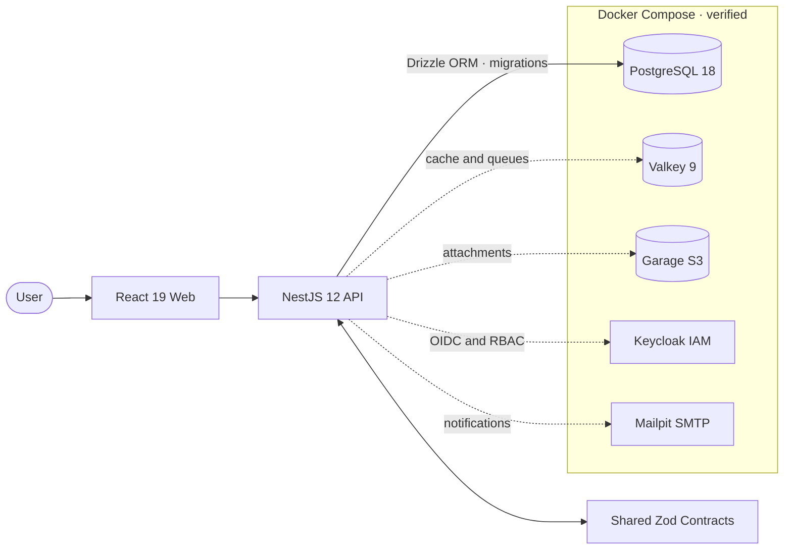

# Tessera

<p align="center">
  <strong>A secure, self-hosted collaboration platform built from an architecture-first foundation.</strong>
</p>

<p align="center">
  
</p>

<p align="center">
  
  
  
  
  
  
</p>

Tessera evolves a coursework architectural MVP into a bachelor-level product without discarding its domain core. The repository combines a typed pnpm monorepo, explicit architectural boundaries, reusable contracts, tested design patterns, and a reproducible self-hosted infrastructure stack.

## What is working now

- React 19 boundary application powered by Vite;
- NestJS 12 API with health, architecture, workspace, project, and task endpoints;
- shared Zod schemas, DTOs, and domain-event contracts;
- domain rules for WIP limits and task state transitions;
- migrated Factory Method, Builder, Singleton, and State patterns;
- PostgreSQL persistence through Drizzle ORM with versioned migrations;
- transactional project setup with a Kanban board and four default columns;
- sequential task keys and database-backed conflict/not-found handling;
- thirteen passing automated tests plus lint, typecheck, and production builds;
- five healthy Docker services with persistent data and loopback-only ports.

## Architecture



PostgreSQL is now part of a complete application vertical slice. Dashed connections identify integrations scheduled for future sprints.

## Persistence vertical slice

Sprint 2 connects the application core to PostgreSQL without leaking ORM details into the application layer. Controllers validate shared Zod contracts, services depend on a repository port, and the Drizzle adapter owns transactions and database error translation.

| Method | Endpoint                                | Outcome                                            |
| ------ | --------------------------------------- | -------------------------------------------------- |
| `POST` | `/api/workspaces`                       | Creates a workspace                                |
| `POST` | `/api/workspaces/:workspaceId/projects` | Creates a project, board, and four Kanban columns  |
| `GET`  | `/api/workspaces/:workspaceId/projects` | Lists persisted projects                           |
| `POST` | `/api/projects/:projectId/tasks`        | Creates a task with a sequential key such as TES-1 |
| `GET`  | `/api/projects/:projectId/tasks`        | Lists persisted project tasks                      |

The initial migration creates seven constrained tables: `users`, `workspaces`, `projects`, `project_memberships`, `boards`, `board_columns`, and `tasks`. E2E tests run against the real containerized database and remove their fixtures afterward.

## Verified infrastructure

| Service    | Pinned image                       | Purpose                             | Local endpoint          | Status     |
| ---------- | ---------------------------------- | ----------------------------------- | ----------------------- | ---------- |
| PostgreSQL | `postgres:18.7-alpine3.24`         | Tessera and Keycloak databases      | `localhost:5432`        | ✅ Healthy |
| Valkey     | `valkey/valkey:9.1.3-alpine3.24`   | Cache, sessions, and future queues  | `localhost:6379`        | ✅ Healthy |
| Garage     | `dxflrs/garage:v2.5.0`             | S3-compatible attachment storage    | `http://localhost:3900` | ✅ Healthy |
| Keycloak   | `quay.io/keycloak/keycloak:26.8.2` | OIDC identity and access management | `http://localhost:8080` | ✅ Healthy |
| Mailpit    | `axllent/mailpit:v1.33.1`          | Safe local email capture            | `http://localhost:8025` | ✅ Healthy |

The Sprint 1B acceptance check confirmed PostgreSQL connectivity, a dedicated Keycloak database, authenticated Valkey access, a healthy Garage node with the `tessera-attachments` bucket, OpenID discovery, Mailpit HTTP access, and five persistent Docker volumes.

## Quick start

### Requirements

- Node.js 24 LTS;
- pnpm 11.25 or compatible;
- Docker Engine with Docker Compose;
- Linux or WSL2 for the documented development workflow.

### Application

```bash
nvm use
corepack enable
pnpm install --frozen-lockfile
pnpm dev
```

| Component        | URL                                      |
| ---------------- | ---------------------------------------- |
| Web application  | <http://localhost:5173>                  |
| API health       | <http://localhost:3001/api/health>       |
| API architecture | <http://localhost:3001/api/architecture> |

### Infrastructure

Generate unique local secrets. The command deliberately refuses to overwrite an existing `.env`:

```bash
pnpm infra:env
```

Start the complete stack and wait for its health checks:

```bash
sudo docker compose up -d --wait --wait-timeout 240
sudo docker compose ps
pnpm db:migrate
```

Useful verification commands:

```bash
sudo docker compose exec -T postgres \
  psql -U tessera -d tessera -c "SELECT current_database(), current_user;"

sudo docker compose exec -T valkey sh -lc \
  'valkey-cli --no-auth-warning -a "$VALKEY_PASSWORD" ping'

sudo docker compose exec -T garage /garage status
```

Stop the stack without deleting persistent data:

```bash
sudo docker compose stop
```

> [!CAUTION]
> `docker compose down --volumes` permanently deletes the local databases, object storage, cache, and captured mail.

## Security-minded development defaults

- generated secrets stay in a gitignored `.env` file;
- the generator creates high-entropy credentials and never prints them;
- published infrastructure ports bind to `127.0.0.1` only;
- containers communicate through the isolated `tessera-backend` network;
- service versions are pinned and startup is guarded by health checks;
- persistent data lives in named Docker volumes.

The current Keycloak configuration uses development mode and is intended for local development only. A production deployment will add TLS, hardened hostnames, secret management, and an optimized Keycloak image.

## Quality gates

```bash
pnpm lint
pnpm typecheck
pnpm test
pnpm build
pnpm db:check
pnpm test:e2e
```

## Repository layout

```text
apps/
  api/       NestJS vertical slices, Drizzle schema, and SQL migrations
  web/       React boundary application
packages/
  shared/    Zod schemas, DTOs, and domain-event contracts
infra/
  garage/    Single-node S3-compatible storage configuration
  postgres/  Idempotent database bootstrap assets
scripts/
  create-local-env.mjs
compose.yaml
```

## Roadmap

<p align="center">
  
</p>

| Status    | Milestone                         | Outcome                                                          |
| --------- | --------------------------------- | ---------------------------------------------------------------- |
| ✅ Done   | **Sprint 1A · Architecture**      | Monorepo, domain core, shared contracts, and design patterns     |
| ✅ Done   | **Sprint 1B · Infrastructure**    | Reproducible, secure, and fully verified self-hosted stack       |
| ✅ Done   | **Sprint 2 · Persistence**        | PostgreSQL integration, ORM schema, migrations, and repositories |
| 🎯 Next   | **Sprint 3 · Identity**           | Keycloak OIDC authentication and role-based access control       |
| ◌ Planned | **Sprint 4 · Platform Services**  | S3 attachments, audit history, and notification delivery         |
| ◌ Planned | **Sprint 5 · Product Experience** | Kanban UI, accessibility, and real-time collaboration            |

**Current focus:** Sprint 3 will connect Keycloak to the verified persistence slice and enforce workspace roles at the API boundary.

---

Built as an architecture-focused coursework project with a clear path to a production-grade bachelor thesis platform.
